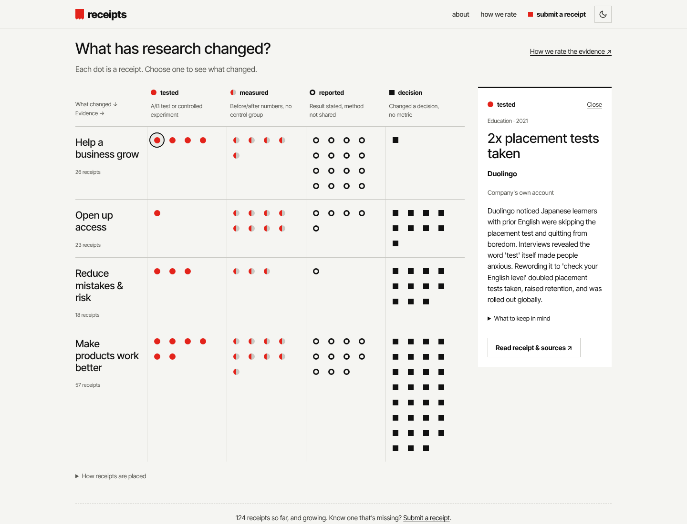
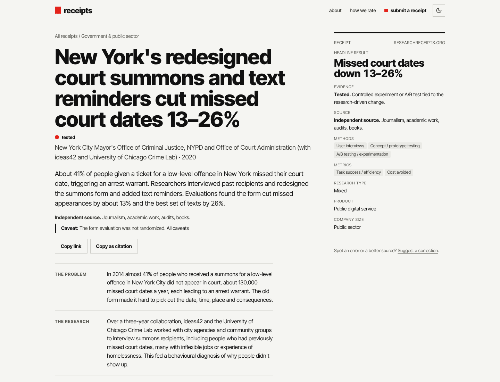

# Receipts

**What has UX research ever done for us?**

A public atlas of documented UX research wins. Find a case, see what the research changed, check the evidence, and take a receipt into your next deck, doc, or budget conversation.

**[Browse Receipts](https://www.researchreceipts.org)** · [Explore the map](https://www.researchreceipts.org/?view=map) · [How we rate evidence](https://www.researchreceipts.org/how-we-rate) · [Submit a receipt](https://www.researchreceipts.org/submit)

[whathasresearcheverdone.com](https://whathasresearcheverdone.com) gets you here too.


**In this README:** [Explore](#two-ways-to-explore) · [Evidence](#evidence-sources-and-caveats) · [Stack](#stack-and-structure) · [Local setup](#run-locally) · [Data and publishing](#data-and-publishing) · [Moderation](#moderation-and-source-checks) · [Analytics](#sharing-caching-and-analytics) · [Contribute](#contribute)

## What you can do

- **Find a relevant case.** Search companies, methods, and outcomes. Narrow the collection by evidence strength, industry, metric, method, product type, company size, research type, or source type.
- **Browse cards or the map.** Cards are the homepage default. The map offers another way to explore the same filtered collection.
- **Check the story behind the number.** Each receipt separates the problem, research, insight, change, and outcome, with attribution, caveats, and sources where available.
- **Cite and share.** Copy an entry link or a formatted citation. Share a filtered results link with its own preview card.
- **Find something unexpected.** “I’m Feeling Lucky” opens a random receipt from the current results. Press `/` to focus search.
- **Contribute a case.** Public submissions go into a private review queue. A moderator reviews them before publication; anonymized cases are welcome.

The collection includes commercial results, public services, accessibility improvements, better product experiences, and decisions to stop or change direction. Research doesn't need a revenue number to count.

## Two ways to explore

### Cards

Cards show the headline outcome, company, evidence level, source context, and a summary. The default “Strongest” sort groups receipts by evidence level; within a level, source type and year help order the results. You can also sort by newest year, oldest year, or date added.

Desktop cards keep filters in a sidebar. Smaller screens use a filter dialog. Search, filters, sorting, and view selection are reflected in the URL, and entry pages provide a way back to your results.

### Evidence map



The map groups receipts by what research changed:

- Help a business grow
- Open up access
- Reduce mistakes & risk
- Make products work better

The columns use the same Tested, Measured, Reported, and Decision labels as the cards. Select a dot to see a receipt preview and open the full case. Map and Cards share search and filters, so switching views keeps the same set of receipts.

Each dot represents one case. Dot size and position don't score impact, estimate ROI, or compare effect sizes. Row assignments are provisional editorial groupings in [`data/impact-groups.json`](data/impact-groups.json). New receipts without an assignment appear under **Not yet grouped**.

See [`docs/evidence-map.md`](docs/evidence-map.md) for grouping rationale, responsive behavior, and review notes.

### Links you can share

| Link | Opens |
| --- | --- |
| [`/`](https://www.researchreceipts.org/) | Cards, the default homepage view |
| [`/?view=map`](https://www.researchreceipts.org/?view=map) | Evidence map |
| [`/?view=cards&evidence_strength=tested`](https://www.researchreceipts.org/?view=cards&evidence_strength=tested) | Tested receipts in Cards |
| [`/?view=map&q=Duolingo`](https://www.researchreceipts.org/?view=map&q=Duolingo) | Map results matching Duolingo |
| [`/?metrics=revenue,conversion`](https://www.researchreceipts.org/?metrics=revenue,conversion) | Receipts tagged revenue or conversion |

Values within a facet are combined with OR; different facets are combined with AND. Search terms must all match. Use the interface's copy-results-link action to build a link without editing query parameters by hand.

## Evidence, sources, and caveats

Every receipt has two separate labels: **evidence strength** and **source type**. A company's own story and an independent account can report the same outcome while giving readers different reasons for caution.

| Evidence level | What it means |
| --- | --- |
| **Tested** | A controlled experiment or A/B test tied to the research-driven change. |
| **Measured** | Before/after metrics, without a control group. |
| **Reported** | An outcome is stated, but the measurement method isn't shared. |
| **Decision** | Research changed a decision, without a reported outcome metric. |

Decision is a different kind of contribution, not a claim that the work mattered less. When a case sits between levels, use the lower one.

Source types distinguish **first-party** accounts, **agency/vendor** accounts, **independent** reporting or analysis, and **community** submissions. Attribution and caveats explain how directly a source connects the research to the result and what a skeptical reader should know.



Entries summarize the sources in our own words. Report numbers exactly as the source states them, and don't infer causation from a redesign story. Published-source entries need a source that was opened and checked; community accounts without a public source are labeled accordingly.

Read the [rating guide](https://www.researchreceipts.org/how-we-rate), [`BRIEF.md`](BRIEF.md), and [`docs/taxonomy.md`](docs/taxonomy.md) for the editorial rules.

<details>
<summary>Mobile homepage</summary>


</details>

Screenshots were captured from the public site on November 25, 2026, after the Fred Troller redesign, in light mode: desktop at 1440 × 1100 and mobile at 390 × 1000. The live collection can change after capture. See [screenshot capture notes](docs/screenshots/README.md) to refresh them.

## Design

The look follows Fred Troller's Swiss/Geigy work: one signal red, warm grey and black on paper, one heavy
grotesque (Inter Tight), flat overlapping geometry. Evidence levels are shapes, not colours: tested = solid
circle, measured = half circle, reported = ring, decision = square (`.ev` badges and `components/EvidenceSign.tsx`).
Entries whose result is two percentages ("27.6% → 72.9%") get area-true circles (`components/ResultCircles.tsx`).
The redesign is the last layer of `app/globals.css`, overriding the earlier rounds above it.

## Stack and structure

- **Next.js 15 App Router**, **React 19**, and **TypeScript**.
- Plain CSS, responsive layouts, and light/dark themes. Fonts: Newsreader, Source Sans 3, and JetBrains Mono through `next/font`.
- **Supabase Postgres** for published entries, submissions, and anonymous product events.
- **Vercel** hosting and Web Analytics.
- `unpdf` for reading PDF sources during moderator source checks.

| Location | Responsibility |
| --- | --- |
| [`app/`](app/) | Pages, server actions, styles, metadata, and image routes |
| [`components/Explorer.tsx`](components/Explorer.tsx) | Shared search, facets, sorting, view state, and results |
| [`components/EvidenceMap.tsx`](components/EvidenceMap.tsx) | Map visualization and selected-receipt preview |
| [`components/EntryCard.tsx`](components/EntryCard.tsx) | Receipt cards and evidence badges |
| [`lib/filters.ts`](lib/filters.ts) | Filtering and shared-link descriptions |
| [`lib/taxonomy.ts`](lib/taxonomy.ts) | Canonical facet values and labels |
| [`lib/impact.ts`](lib/impact.ts) | Map groups and receipt assignments |
| [`lib/supabase.ts`](lib/supabase.ts) | Public data client, entry queries, and caching |
| [`lib/sourcecheck.ts`](lib/sourcecheck.ts) | Source extraction and figure matching for moderation |
| [`data/seed/`](data/seed/) | Editorial seed batches |
| [`scripts/`](scripts/) | Seed validation/loading, thumbnails, and scout submissions |
| [`supabase/migrations/`](supabase/migrations/) | Database tables, policies, and RPCs |
| [`docs/`](docs/) | Taxonomy, entry format, map notes, scout workflow, and screenshots |

## Run locally

Use a current Node.js LTS release; Node 22 is a reasonable choice. Install dependencies from the committed lockfile:

```bash
git clone https://github.com/jessholbrook/receipts.git
cd receipts
npm ci
npm run dev
```

Open **http://localhost:3000**. The data client has defaults for the existing public Supabase project, so browsing doesn't require local secrets. This is live data, not an offline fixture. Public submission actions can write to the live review queue; use your own database when testing writes.

To use another project, create `.env.local`:

```dotenv
NEXT_PUBLIC_SUPABASE_URL=https://YOUR_PROJECT.supabase.co
NEXT_PUBLIC_SUPABASE_PUBLISHABLE_KEY=YOUR_PUBLISHABLE_KEY
NEXT_PUBLIC_SITE_URL=http://localhost:3000
```

| Variable | Purpose |
| --- | --- |
| `NEXT_PUBLIC_SUPABASE_URL` | Supabase project URL; defaults to the existing public project. |
| `NEXT_PUBLIC_SUPABASE_PUBLISHABLE_KEY` | Public API key; access is controlled by database policies and RPCs. |
| `NEXT_PUBLIC_SITE_URL` | Canonical origin for metadata and generated links; defaults to `https://www.researchreceipts.org`. |
| `RECEIPTS_ADMIN_TOKEN` | Moderator passphrase used by maintenance scripts that publish or update records. Never prefix it with `NEXT_PUBLIC_`. |

Next.js loads `.env.local`. The standalone scripts read `process.env` directly, so export their variables in your shell or pass them with the command. Keep moderator credentials out of committed files.

### Checks and production build

```bash
npm run lint
npm run build
npm start
```

`npm start` serves an already-built app. The production build needs network access: Next fetches Google fonts, and entry-page generation reads published entries from Supabase. `supabase/seed.json` isn't an automatic offline fallback.

For UI changes, check both Cards and Map at desktop and phone widths. Search, apply a facet, switch views, open a receipt, and return to results. Also check empty results, copied links/citations, and both themes when relevant. There isn't a dedicated automated test command in `package.json`.

## Data and publishing

### Using your own database

The schema is versioned in [`supabase/migrations/`](supabase/migrations/). Apply the SQL files to your own Supabase project in numeric order, from `0001_init.sql` through the latest migration. They include the base schema, admin upserts, scout deduplication, thumbnails, approximate years, and product events.

For a fresh project, initialize the moderator hash in the SQL editor:

```sql
insert into public.admin_secrets (id, passphrase_hash)
values (1, extensions.crypt('REPLACE_WITH_YOUR_PASSPHRASE', extensions.gen_salt('bf', 10)));
```

For an existing installation, rotate it with:

```sql
update public.admin_secrets
set passphrase_hash = extensions.crypt('REPLACE_WITH_YOUR_PASSPHRASE', extensions.gen_salt('bf', 10))
where id = 1;
```

The app uses a publishable key rather than a service-role key. Public API access is intentionally narrow:

| Data | Public access |
| --- | --- |
| `entries` | Read published rows; no direct public writes. |
| `submissions` | Insert pending submissions; no public reads. |
| `events` | Insert recognized event names; no public reads. |
| `admin_secrets` | No public access. |

Moderator operations run through `admin_*` security-definer functions that validate the passphrase against the stored bcrypt hash. The internal `_admin_ok` helper isn't publicly executable. `admin_check` adds a 300 ms delay per call. The scout deduplication RPC exposes slugs submitted from the scout address, not human submission details.

Supabase's advisor may flag anonymous execution of privileged admin functions. Those functions are part of this app's passphrase-based moderation design; review their checks when changing them. RLS and explicit authorization remain essential.

### Add or edit seed entries

1. Read [`docs/entry-schema.md`](docs/entry-schema.md) and use values from [`lib/taxonomy.ts`](lib/taxonomy.ts).
2. Add or update a JSON batch in `data/seed/`. Open the sources, check the headline claim, and write the attribution and caveats.
3. Validate and regenerate `supabase/seed.json` and the ignored `supabase/seed.sql`:

   ```bash
   node scripts/build-seed.mjs
   ```

4. Check the console for dropped values or skipped entries, then review the diff in both the batch and `supabase/seed.json`. The script reports problems without necessarily exiting with an error.
5. To publish the validated seed data to the configured database, a moderator runs:

   ```bash
   RECEIPTS_ADMIN_TOKEN='YOUR_MODERATOR_PASSPHRASE' node scripts/load-seed.mjs
   ```

The loader upserts by slug. A commit to `data/seed/` alone doesn't update the live database. Keep `docs/taxonomy.md` in sync when changing the canonical taxonomy, and update `data/impact-groups.json` to place a new receipt in a map row.

### Thumbnails

Cards use preview images supplied by source pages (`og:image` or Twitter image metadata). The fetcher rejects repeated site-wide images and homepage defaults. Manual vetoes live in [`data/thumbnail-blocklist.json`](data/thumbnail-blocklist.json).

```bash
# With RECEIPTS_ADMIN_TOKEN unset: fetch candidates without database updates.
node scripts/fetch-thumbnails.mjs

# Refresh only missing thumbnails and save them to the configured database.
RECEIPTS_ADMIN_TOKEN='YOUR_MODERATOR_PASSPHRASE' node scripts/fetch-thumbnails.mjs --only-missing
```

### Scout candidates

[`scripts/scout-submit.mjs`](scripts/scout-submit.mjs) validates candidate JSON, checks published receipts and earlier scout submissions, and sends new candidates to the review queue. It doesn't publish them.

```bash
node scripts/scout-submit.mjs path/to/candidates.json --dry-run
node scripts/scout-submit.mjs path/to/candidates.json
```

The dry run still reads the configured database for duplicate checks. The script is separate from the external monthly schedule described in [`docs/scout.md`](docs/scout.md); cloning or deploying this repo doesn't create that schedule.

## Moderation and source checks

Open `/admin` and sign in with the moderator passphrase. The queue provides editable entry JSON, a review checklist, and automated source checks. Correct the slug, wording, evidence rating, and source details before approving. Rejections can include a private note. Approval publishes the entry and clears the shared entry cache.

The review checklist emphasizes two recurring problems: headline figures that the first source doesn't actually state, and unsupported details added at the end of a section.

The source checker reads HTML, PDFs, and Medium posts through RSS. It looks for key figures and shows matching source sentences. It flags missing headline numbers, claims supported only by later sources, and unsupported figures in section endings. **A text match isn't proof. Read the sentence and its context.** Use “Re-check edited JSON” after making changes.

Because the checker fetches submitted URLs, its endpoint is moderator-only. It rejects private/internal destinations and nonstandard ports at every redirect hop, with an 8 MB and 12 second cap per source. See [`lib/sourcecheck.ts`](lib/sourcecheck.ts) and [`app/admin/source-check/route.ts`](app/admin/source-check/route.ts).

## Sharing, caching, and analytics

Each public page defines its own social preview metadata through [`lib/share.ts`](lib/share.ts). Entry links have receipt-specific images. Filtered homepage links use the same filtering logic as the explorer to generate a title, count, description, and image at `/og/filtered`.

The published entry list is cached for five minutes with the `entries` tag. Moderator approval invalidates it immediately. Direct maintenance scripts don't invoke that Next.js invalidation action; allow for cached results when reviewing their updates.

Traffic uses Vercel Web Analytics; enable it in the Vercel project's Analytics tab. Anonymous product events include searches, filters, source opens, copied citations/links, Lucky, shared-link landings, and successful submissions. These are stored in `events` and summarized in `/admin` → **activity**.

The custom event tracker stores no cookies, visitor IDs, or IP addresses and skips visitors with Do Not Track or Global Privacy Control enabled. Local event tracking is off by default. To opt in for a local check:

```js
localStorage.setItem('receipts-track-local', '1');
```

That opt-in sends events to the configured database. Remove the key to turn it off again. See [`lib/track.ts`](lib/track.ts) for the event names and guards.

## Contribute

- **Have a case?** [Submit a receipt](https://www.researchreceipts.org/submit). Include what research found, what changed, the outcome, and any sources or caveats you can share.
- **Found a mistake?** [Open an issue](https://github.com/jessholbrook/receipts/issues/new) with the receipt link, correction, and supporting source.
- **Changing code or content?** Open a PR with the problem, resulting behavior, and relevant checks. Keep evidence labels and source claims consistent with the editorial rules.

Useful references: [project brief](BRIEF.md) · [taxonomy](docs/taxonomy.md) · [entry schema](docs/entry-schema.md) · [evidence map](docs/evidence-map.md) · [scout workflow](docs/scout.md).
